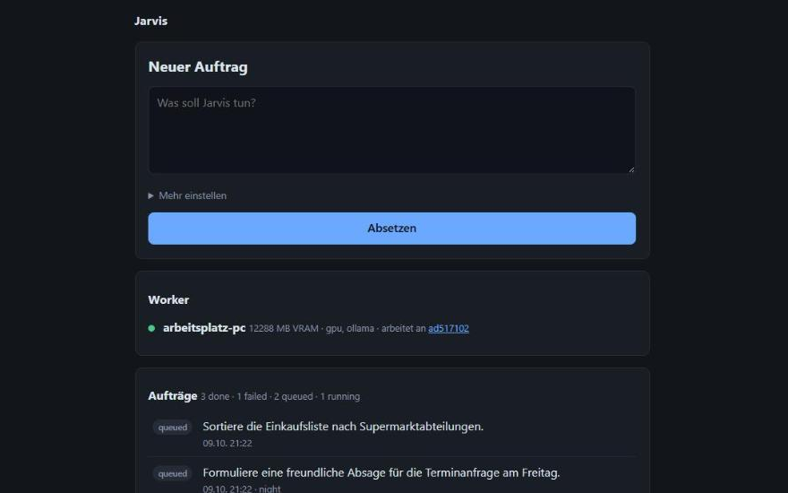
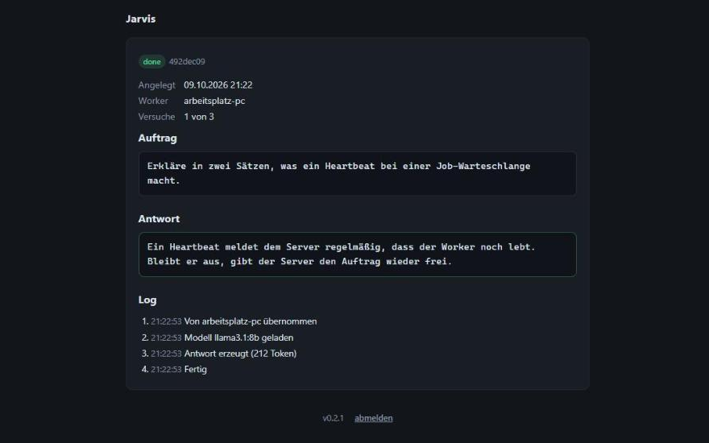

# Jarvis

*Self-hosted job queue for local LLM work. A 24/7 orchestrator (FastAPI + SQLite)
takes jobs via web UI or REST and leases them to pull-based workers that may be
offline at submit time. Leases with heartbeats, a job state machine, and
hardware-aware scheduling (VRAM, tags, time window). 162 tests. No paid APIs.*

---

Selbst gehostetes LLM-Harness. Aufträge gehen per Weboberfläche oder REST-API
rein, warten in einer Queue und werden von dem Rechner abgearbeitet, der gerade
läuft und die passende Hardware hat. Alles lokal, keine bezahlten APIs, keine
Cloud-Modelle.

Der Kern ist eine Aufgabenteilung: Ein kleiner Dauerläufer verwaltet die
Aufträge, und beliebig viele Worker holen sich Arbeit ab. Der rechnende Rechner
darf ausgeschaltet sein — Aufträge warten dann einfach.

```
Handy / Browser
      |  HTTPS über Tailscale (nötig fürs Mikrofon)
      v
ORCHESTRATOR (Homeserver, Port 8400)   FastAPI + SQLite, läuft 24/7
      ^
      |  Worker fragen nach Arbeit (Pull)
   Worker "gpu-pc"          Worker "gpu-3090" (geplant)
   Windows, Ollama          48 GB VRAM
```

Warum es so gebaut ist, steht in [docs/ARCHITECTURE.md](docs/ARCHITECTURE.md),
die Phasen in [docs/ROADMAP.md](docs/ROADMAP.md), und was konkret ansteht in
[docs/TODO.md](docs/TODO.md).

**Stand:** Phase 2. Text- und Sprachaufträge laufen durch. Home Assistant und
Nacht-Jobs sind vorbereitet, aber noch nicht gebaut.

## Screenshots

Aufgenommen mit erfundenen Demo-Aufträgen.

| Dashboard | Job-Detail |
|---|---|
|  |  |

## Schnellstart auf einem Rechner

Für einen ersten Blick reichen Orchestrator und Worker auf derselben Maschine.
Voraussetzung: Python 3.11 oder neuer, und ein laufendes
[Ollama](https://ollama.com) mit mindestens einem Modell (`ollama pull llama3.1:8b`).

```bash
git clone <pfad-zum-repo> Jarvis && cd Jarvis

python -m venv .venv
.venv/Scripts/python -m pip install -e ".[dev]"    # Linux: .venv/bin/python

cp .env.example .env
# JARVIS_TOKEN setzen:
.venv/Scripts/python -c "import secrets; print(secrets.token_urlsafe(32))"
```

Orchestrator starten:

```bash
.venv/Scripts/python -m jarvis.main
```

Im Browser `http://localhost:8400` öffnen und das Token aus der `.env`
eingeben. Ein Auftrag lässt sich sofort absetzen — er bleibt auf `queued`
stehen, weil noch kein Worker läuft. Das ist richtig so.

Worker in einem zweiten Fenster:

```bash
cp worker/worker.example.yaml worker/worker.yaml
# darin token eintragen (dasselbe wie JARVIS_TOKEN) und orchestrator auf
# http://127.0.0.1:8400 setzen
.venv/Scripts/python -m worker.agent
```

Der wartende Auftrag läuft jetzt an.

## Dauerbetrieb

Orchestrator auf dem Homeserver, Worker auf dem PC mit der Grafikkarte:

- [docs/SETUP-SERVER.md](docs/SETUP-SERVER.md) — venv, systemd-Unit, Deploy,
  Zugriff von unterwegs
- [docs/SETUP-WORKER.md](docs/SETUP-WORKER.md) — Ollama richtig konfigurieren,
  Worker als Windows-Aufgabe, Modellwahl für 6 GB VRAM

Deployen aus dem Projektordner heraus:

```bash
bash deploy.sh
```

Das Skript prüft erst Lint und Tests und lädt nur bei grün hoch. Es überträgt
niemals `.env`, `worker.yaml` oder die Datenbank.

## Aufbau

| Ordner | Inhalt |
|---|---|
| `jarvis/` | Orchestrator: Queue, Registry, Scheduler, API, Oberfläche |
| `worker/` | Worker: Poll-Schleife und Runner (aktuell nur Ollama) |
| `docs/` | Architektur, Roadmap, Setup |
| `deploy/` | systemd-Unit und Anleitung für die Windows-Aufgabenplanung |
| `tools/` | Hilfsskripte, etwa zum Erzeugen der App-Symbole |
| `tests/` | 162 Tests |

Die wichtigsten Dateien, wenn man sich einarbeitet: `jarvis/queue.py` hält den
Zustandsautomaten der Jobs, `jarvis/scheduler.py` entscheidet, welcher Job zu
welchem Worker passt, `worker/agent.py` ist die Schleife auf der Worker-Seite.

## Wie ein Auftrag durchläuft

```
queued ---claim---> assigned ---start---> running ---> done
   ^                    |                    |
   +---- Lease abgelaufen, attempts + 1 -----+
   |
   +---> failed (keine Versuche mehr)   +---> cancelled
```

Ein Job wird nicht zugewiesen, sondern **verpachtet**. Der Worker verlängert
den Lease mit jedem Heartbeat. Wird der PC mitten im Job ausgeschaltet, läuft
der Lease ab und der Job geht zurück in die Queue, statt für immer auf
`running` zu stehen.

Jeder Job hat eine Priorität, ein erlaubtes Zeitfenster (`any`, `day`,
`night`), geforderte Tags, einen Mindest-VRAM-Bedarf und optional ein Modell.
Ein Worker bekommt nur Jobs, die er auch erfüllen kann.

## Als App installieren

Danach liegt Jarvis mit eigenem Symbol auf dem Startbildschirm und öffnet sich
in einem eigenen Fenster ohne Adresszeile.

**Bedingung: HTTPS oder localhost.** Über `http://homeserver:8400` bietet
kein Browser das Installieren an, und das Mikrofon bleibt ebenfalls gesperrt.

### Handy

`https://homeserver.tailnet.ts.net:10000` öffnen, anmelden.

Auf Android fragt Chrome von selbst, sonst über das Dreipunktmenü unter
„App installieren". Auf dem iPhone geht es nur in Safari, über den
Teilen-Knopf und „Zum Home-Bildschirm".

### Dieser PC

Der PC ist nicht im Tailnet, deshalb ist die HTTPS-Adresse hier nicht
erreichbar. Zwei Wege:

**Tailscale installieren** (der dauerhafte Weg). Nach der Anmeldung mit
demselben Konto ist `https://homeserver.tailnet.ts.net:10000` auch von hier
aus erreichbar, samt Mikrofon und Installation.

**Oder einen SSH-Tunnel**, wenn es nur schnell gehen soll:

```powershell
ssh -N -L 8400:127.0.0.1:8400 you@homeserver
```

Solange das Fenster offen bleibt, ist `http://localhost:8400` erreichbar — und
localhost gilt dem Browser als sicher. In Chrome dann über das Symbol in der
Adresszeile oder das Dreipunktmenü installieren.

## Es gibt zwei Token

Eine Stolperfalle, die einen garantiert einmal erwischt: Jede Installation hat
ihr **eigenes** `JARVIS_TOKEN`.

| Wo | Datei | Wofür |
|---|---|---|
| Homeserver | `~/jarvis/.env` | der Dienst im Dauerbetrieb — dieses Token braucht das Handy |
| Dieser PC | `Jarvis/.env` | nur zum Entwickeln, wenn der Orchestrator lokal läuft |

`deploy.sh` überträgt die `.env` **nie**. Beim ersten Deploy legt es auf dem
Server eine eigene an und würfelt dort ein frisches Token. Das ist Absicht: So
liegt das Entwicklungs-Geheimnis nie auf dem Server, und das Server-Geheimnis
nie im Repo.

Das Token des Servers holt man sich so:

```bash
ssh you@homeserver "grep '^JARVIS_TOKEN=' ~/jarvis/.env"
```

Dasselbe Token gehört in `worker/worker.yaml` auf dem PC — der Worker meldet
sich ja beim Server an, nicht bei der lokalen Installation.

## Sprachnachrichten

Auf dem Dashboard gibt es einen Knopf „Sprechen". Aufnehmen, stoppen, fertig —
der gesprochene Satz wird transkribiert und als ganz normaler Auftrag
eingereiht.

**Dafür muss die Seite über HTTPS geöffnet sein.** Browser geben das Mikrofon
nur auf HTTPS oder auf localhost frei. Am Handy also
`https://homeserver.tailnet.ts.net:10000` verwenden, nicht die
HTTP-Adresse — sonst passiert beim Druck auf den Knopf nichts Sinnvolles.

Transkribiert wird lokal von `wyoming-whisper` auf dem Homeserver. Das Modell
`base` läuft etwa in Echtzeit und reicht für kurze Kommandos, verhaspelt sich
aber bei Eigennamen. Die Messung gegen das größere `small` steht in
`docs/SETUP-SERVER.md`.

Aufgenommen wird über die Web-Audio-API statt über den MediaRecorder, weil auf
dem Server kein ffmpeg installiert ist und das übliche webm/opus dort niemand
dekodieren könnte. Der Browser baut deshalb direkt eine WAV-Datei.

Per API geht es auch:

```bash
curl -X POST https://homeserver.tailnet.ts.net:10000/api/jobs/audio \
  -H "X-Jarvis-Token: $TOKEN" -F "audio=@aufnahme.wav"
```

Angenommen wird nur WAV mit 16 bit. Die Abtastrate ist egal, Whisper rechnet um.

## API

Alles hinter dem Token, entweder im Header `X-Jarvis-Token` oder im Cookie
`jarvis_token` (das setzt die Anmeldeseite). `GET /healthz` ist frei.

```bash
TOKEN=$(grep '^JARVIS_TOKEN=' .env | cut -d= -f2)

# Auftrag absetzen
curl -X POST http://homeserver:8400/api/jobs \
  -H "X-Jarvis-Token: $TOKEN" -H "Content-Type: application/json" \
  -d '{"prompt":"Was steht als Naechstes an?"}'

# Nachsehen
curl "http://homeserver:8400/api/jobs?status=queued" -H "X-Jarvis-Token: $TOKEN"
curl "http://homeserver:8400/api/jobs/<id>"          -H "X-Jarvis-Token: $TOKEN"
curl "http://homeserver:8400/api/jobs/<id>/logs"     -H "X-Jarvis-Token: $TOKEN"
curl "http://homeserver:8400/api/workers"            -H "X-Jarvis-Token: $TOKEN"
```

Die vollständige Beschreibung erzeugt FastAPI selbst: `http://.../docs`.

Felder beim Absetzen, alle optional außer `prompt`: `model`, `system`,
`priority` (0–999, kleiner ist wichtiger), `window`, `required_tags`,
`min_vram_mb`, `max_attempts`.

## Entwickeln

```bash
.venv/Scripts/python -m pytest        # 162 Tests
.venv/Scripts/python -m ruff check .
```

`tests/test_nebenlaeufig.py` fährt einen echten Uvicorn hoch und feuert
parallele Anfragen dagegen. Der Test existiert, weil eine frühere Fassung sich
unter Last festgefahren hat und der `TestClient` das nicht zeigen konnte — er
arbeitet Anfragen nacheinander im selben Thread ab.

## Sicherheit

Ein einziges Geheimnis, `JARVIS_TOKEN`, für alles. Kein Nutzerkonto, keine
Rollen — es gibt einen Nutzer, und der Dienst läuft im LAN und im Tailnet. Das
Token soll verhindern, dass ein versehentlich offener Port sofort benutzbar
ist, mehr nicht.

Kein Port-Forwarding ins Internet. Von unterwegs geht der Zugriff über
Tailscale.

Geheimnisse stehen ausschließlich in `.env` (Orchestrator) und
`worker/worker.yaml` (Worker). Beide sind in `.gitignore`; eingecheckt sind
nur die Vorlagen mit Platzhaltern.

## Wenn etwas nicht geht

**Aufträge bleiben auf `queued`.** Läuft ein Worker? `GET /api/workers` zeigt
`state`. Steht dort `offline`, hat sich der Worker länger als
`JARVIS_HEARTBEAT_TIMEOUT` Sekunden nicht gemeldet. Passt der Job überhaupt zum
Worker — genug VRAM, richtige Tags, Modell vorhanden?

**Job scheitert mit „Ollama nicht erreichbar".** Auf dem Worker-Rechner
`ollama list` ausführen. Läuft Ollama auf einem anderen Rechner als der Worker,
muss `OLLAMA_HOST` dort auf `0.0.0.0` stehen, sonst hört es nur auf localhost.

**Job hängt auf `running`.** Der Worker ist weg. Nach Ablauf des Lease
(`JARVIS_LEASE_SECONDS`, Standard 300) holt der Aufräumer den Job zurück.
Sofort erzwingen:
`curl -X POST .../api/maintenance/reap -d '{"force":true}' -H "X-Jarvis-Token: $TOKEN" -H "Content-Type: application/json"`

**Es gibt keinen Installieren-Knopf.** Die Seite ist über HTTP geöffnet.
Installieren geht nur über HTTPS oder localhost, siehe „Als App installieren".

**Der Aufnahmeknopf tut nichts.** Die Seite ist über HTTP geöffnet. Browser
geben das Mikrofon nur auf HTTPS oder localhost frei — die HTTPS-Adresse über
Tailscale verwenden.

**Der Aufnahmeknopf fehlt ganz.** Die Spracherkennung ist aus
(`JARVIS_STT_ENABLED=false`) oder war beim Start des Dienstes nicht erreichbar.

**„Die Spracherkennung hat nichts verstanden".** Zu leise oder zu kurz. Das
Modell `base` braucht deutlich gesprochene, zusammenhängende Sätze.

**Das Token wird abgelehnt.** Fast immer das falsche: Der Dienst auf dem
Homeserver hat ein anderes als die lokale Installation auf dem PC. Siehe „Es
gibt zwei Token" weiter oben.

**Die Oberfläche fragt immer wieder nach dem Token.** Das Cookie ist
`httponly` und an den Host gebunden. Wer über `homeserver:8400` anmeldet und
später über den Tailscale-Namen kommt, muss sich dort erneut anmelden.

**Der Dienst antwortet nicht.**
`systemctl --user status jarvis` und `tail -f ~/logs/jarvis.log` auf dem
Server. Bei nicht-interaktivem SSH vorher
`export XDG_RUNTIME_DIR=/run/user/$(id -u)`.
